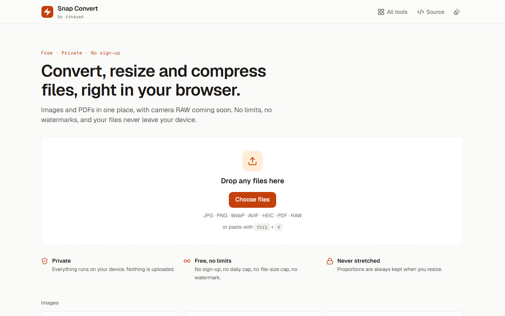
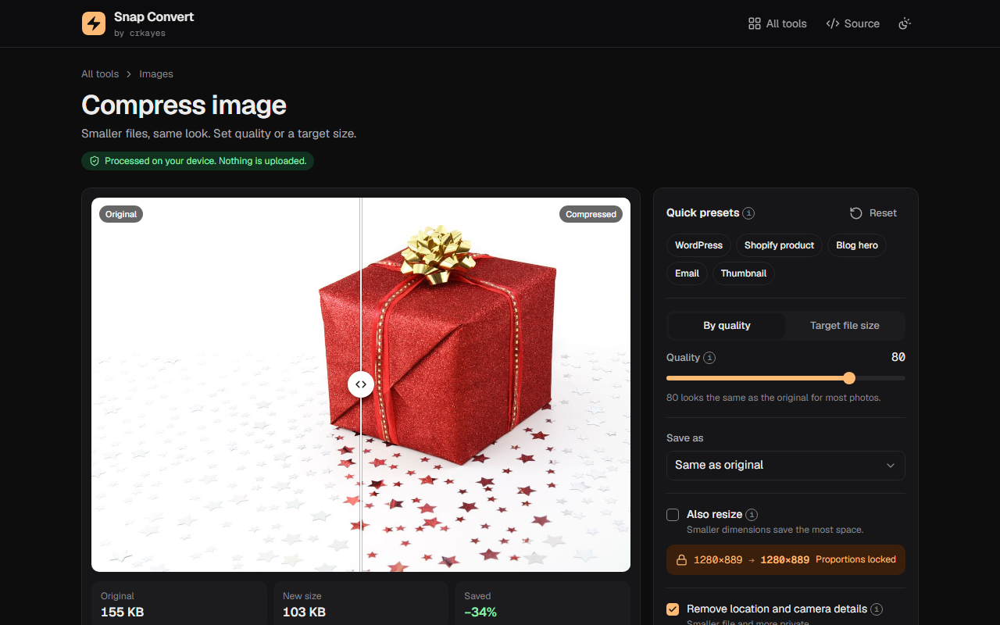
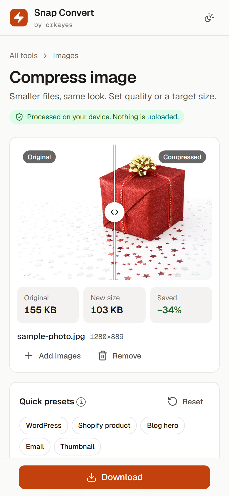

# Snap Convert

Convert, resize, compress and clean up images and PDFs for free, right in your browser — without
uploading anything.

**Use it:** [crkayes.com/snap-convert/](https://crkayes.com/snap-convert/)

Snap Convert is a static web app. All processing runs on your own device in Web Workers and
WebAssembly; there is no server that sees your files.

| Home (light)                                             | Compress image (dark)                                                     | Phone                                                                 |
| -------------------------------------------------------- | ------------------------------------------------------------------------- | --------------------------------------------------------------------- |
|  |  |  |

## What it does

**Images**

- **Compress image** — quality or a target file size, before/after slider, one-tap presets for
  WordPress, Shopify, blog heroes, email and thumbnails.
- **Resize image** — max width, max height, longest side or percentage; exact sizes with Fit
  (padding) or Fill (crop). Never stretched, never enlarged by default.
- **Convert image** — JPG, PNG, WebP, AVIF, GIF (first frame), BMP and HEIC in; JPG, PNG, WebP and
  AVIF out. Plus quick format pages (PNG to JPG, JPG to WebP, …).
- **HEIC to JPG** — iPhone photos to upright JPGs.
- **Optimize for web** — one click per destination; metadata removed.
- **Bulk resize & compress** — a hundred images or more, time left, one ZIP.

**PDFs**

- **Images to PDF**, **Merge PDF**, **Split PDF**, **Organize pages** (reorder, rotate, delete) and
  **Resize PDF** (e.g. A4 ↔ Letter, scaled to fit, never stretched).

**Everywhere**

- Drop any file on the home page and it suggests the right tool.
- Works on phones; installable; works offline once a tool has been used.
- Light and dark themes, remembered settings, help tips.

Coming soon: remove background, RAW to JPG, PDF to images.

## Privacy promise

- **Your files never leave your device.** No uploads, ever. Every end-to-end test fails if a network
  request could carry file data.
- **No accounts, no cookies, no ads, no trackers.** Visits and tool runs can be counted with a
  cookie-free counter on our own server that never receives file names, sizes or contents (off
  unless configured; see [the privacy page](https://crkayes.com/snap-convert/privacy)).
- **Never stretched, never enlarged by default.** Images and PDF pages keep their proportions; exact
  sizes use "fit with padding" or "crop to fill".
- **Smaller, never worse-looking.** Results are checked with a visual similarity score (SSIM ≥ 0.97
  at default settings).

## Requirements

- Node.js 26 (see `.nvmrc`)
- pnpm 12 (`packageManager` in `package.json`)

## Run it locally

```sh
pnpm install
pnpm dev        # http://localhost:5173/snap-convert/
```

## Commands

| Command                                                | What it does                                                                     |
| ------------------------------------------------------ | -------------------------------------------------------------------------------- |
| `pnpm install`                                         | Install dependencies                                                             |
| `pnpm exec playwright install chromium firefox webkit` | Install the browsers used by tests (once)                                        |
| `pnpm dev`                                             | Start the dev server at `http://localhost:5173/snap-convert/`                    |
| `pnpm build`                                           | Build static files into `build/client/` (deploy that folder as `/snap-convert/`) |
| `pnpm preview`                                         | Serve the production build locally                                               |
| `pnpm lint`                                            | ESLint (no warnings allowed)                                                     |
| `pnpm format`                                          | Format with Prettier                                                             |
| `pnpm typecheck`                                       | Generate route types and run TypeScript                                          |
| `pnpm test`                                            | Unit tests (happy-dom) and browser tests (real Chromium)                         |
| `pnpm test:unit` / `pnpm test:browser`                 | One of the two test projects                                                     |
| `pnpm e2e`                                             | Playwright end-to-end tests: Chromium and WebKit at desktop and phone sizes      |
| `pnpm e2e:all`                                         | Same, plus Firefox (also on when `CI` or `E2E_FIREFOX=1` is set)                 |
| `pnpm quality`                                         | Image quality report (`tests/quality/`) in real Chromium                         |

Firefox e2e is opt-in locally because Playwright's Firefox build fails to launch on the Windows 10
dev machine (mozglue side-by-side error); CI (`.github/workflows/ci.yml`) runs all three browsers.

The dev and preview servers send `Cross-Origin-Opener-Policy: same-origin` and
`Cross-Origin-Embedder-Policy: credentialless`; production sends the same headers.

## Deploying

Production is plain static files served by nginx at `crkayes.com/snap-convert/`. The deploy kit is
in [`deploy/`](deploy/) and the owner's step-by-step guide is
[docs/launch/checklist.md](docs/launch/checklist.md).

| Command                                                        | What it does                                                                                                 |
| -------------------------------------------------------------- | ------------------------------------------------------------------------------------------------------------ |
| `deploy\deploy.ps1` / `sh deploy/deploy.sh`                    | Build, check, upload a new release over SSH, switch to it, reload nginx, keep 3 releases, print the rollback |
| `… -DryRun` / `… --dry-run`                                    | Same up to the upload; prints the commands instead                                                           |
| `node deploy/smoke.ts`                                         | Smoke test of the local build behind a stand-in for the nginx headers                                        |
| `node deploy/smoke.ts --url https://crkayes.com/snap-convert/` | Smoke test of the live site                                                                                  |
| `node deploy/check-build.ts`                                   | Check every path in `build/client` is under `/snap-convert/` and list sizes                                  |
| `node --test deploy/`                                          | Tests for the deploy kit                                                                                     |

The Content-Security-Policy allows the pre-rendered pages' inline scripts by hash, so it is generated
from each build ([docs/launch/headers.md](docs/launch/headers.md)). Server settings live in
`deploy/.env` (git-ignored; see `deploy/.env.example`), never in the repository.

## Project layout

See [docs/05-architecture.md](docs/05-architecture.md). Shared TypeScript contracts live in
`src/core/contracts/`.

## License

Snap Convert is free software under the [GNU Affero General Public License v3.0](LICENSE).
The in-app [credits page](https://crkayes.com/snap-convert/credits) lists every library it uses and
its license.
